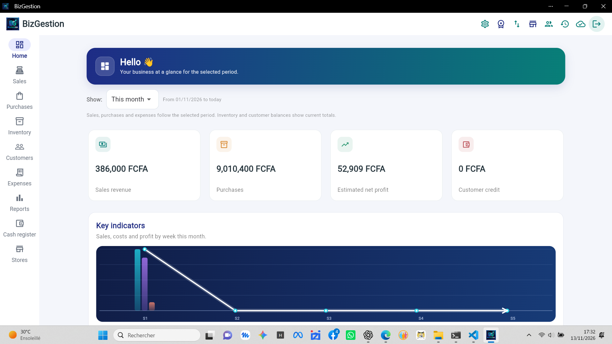
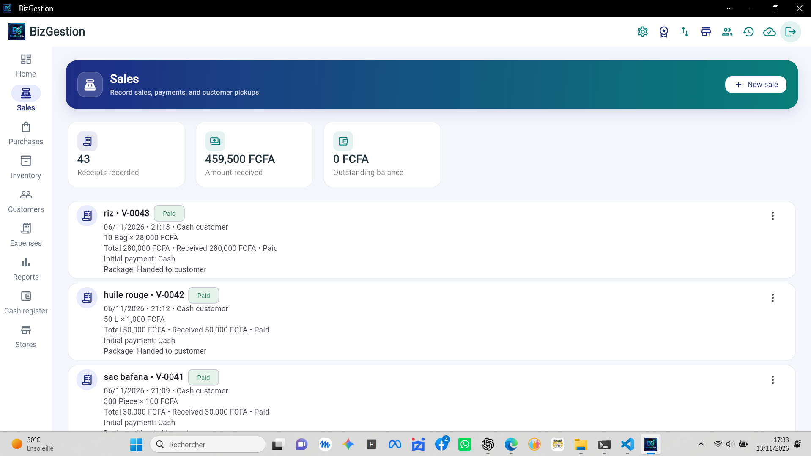
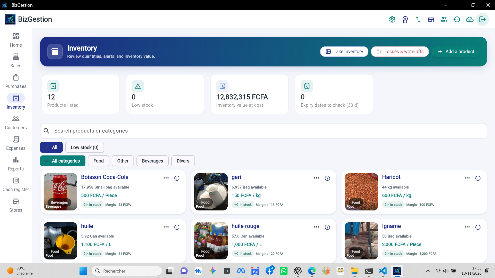
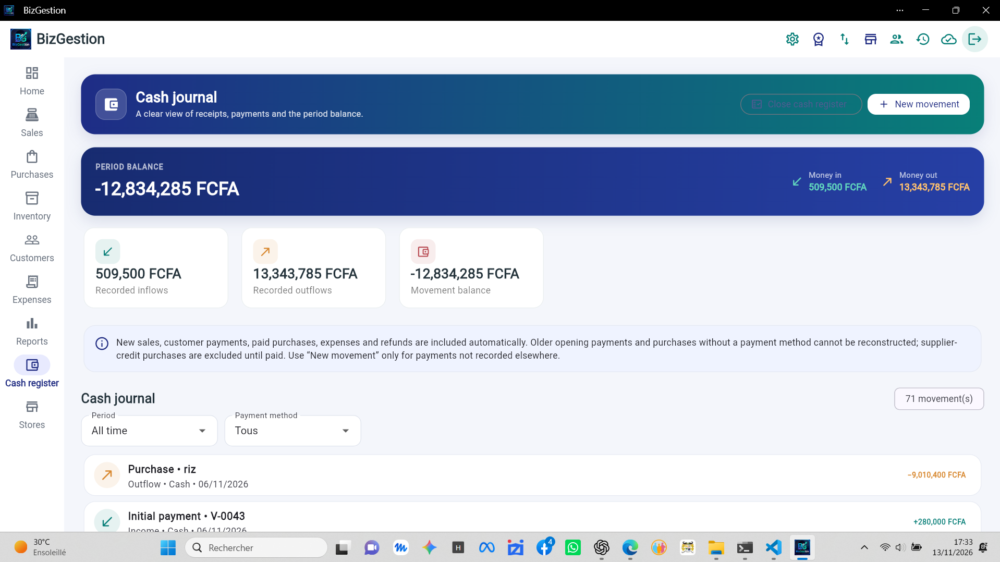
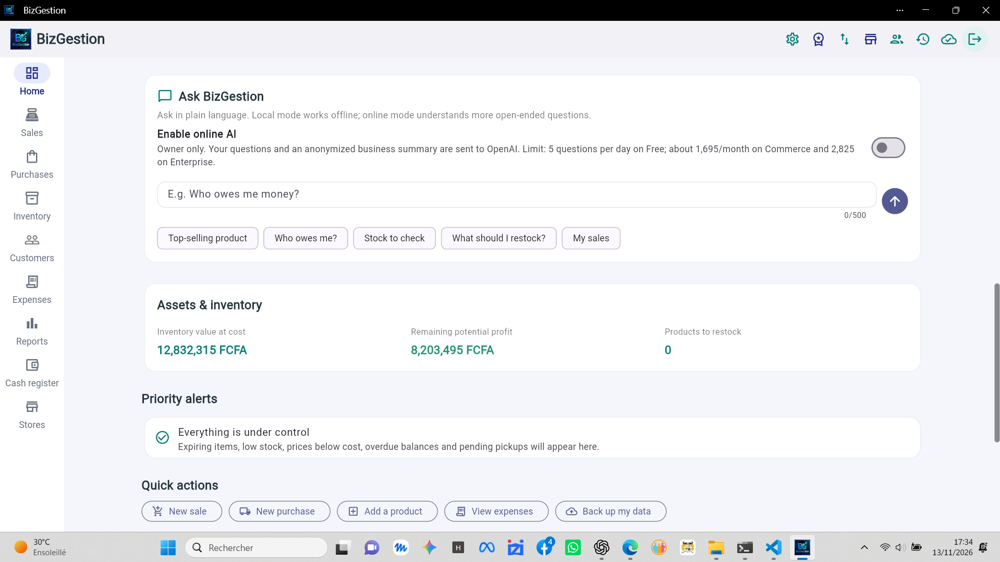

 HEAD
# bizgestion
Application de gestion pour commerces : ventes, stock, achats, dépenses, caisse et assistant IA, avec un fonctionnement en ligne et hors ligne.

# BizGestion

Application de gestion commerciale pour suivre les ventes, les achats, le stock, les clients, les dépenses et la caisse depuis Android, iOS, le Web et les ordinateurs de bureau.

## Fonctions

- Tableau de bord et indicateurs filtrés par période.
- Ventes, achats, produits, fournisseurs, clients, crédits et paiements.
- Recherche de produits tolérante aux fautes de frappe et lecture de codes-barres.
- Dépenses, mouvements de caisse et rapports imprimables ou PDF.
- Gestion d’équipe avec rôles propriétaire, administrateur et employé.
- Données locales avec synchronisation Supabase et sauvegarde/restauration JSON.
- Photos de produits conservées dans un espace Supabase privé.

## Démarrage

Prérequis : Flutter installé et configuré, puis un projet Supabase avec les scripts SQL BizGestion appliqués.

Dans PowerShell, depuis le dossier du projet :

```powershell
flutter pub get
flutter run
```

Pour lancer l’application Web :

```powershell
flutter run -d chrome
```

## Configuration Supabase

Les paramètres publics de connexion sont initialisés dans `lib/main.dart`. La clé publishable/anon peut être intégrée à une application cliente; ne jamais y placer une clé `service_role` ni un secret Supabase.

Appliquer les scripts depuis **Supabase > SQL Editor**, dans cet ordre :

1. `supabase_business_data.sql` — tables, accès et fonctions de synchronisation.
2. `supabase_business_subscriptions.sql` — essai et limites de base par forfait.
3. `supabase_team_access.sql` — invitations et gestion des membres.
4. `supabase_business_realtime.sql` — signalement des changements entre appareils.
5. `supabase_product_images.sql` — stockage privé des photos de produits.
6. `supabase_business_normalization.sql` — copie indexée, sauvegarde par modifications, chargement paginé des ventes et RPC paginée réutilisable pour les autres collections.

Les règles de sécurité RLS doivent rester activées. Après toute modification des politiques d’accès, réexécuter le script correspondant dans le projet Supabase utilisé par l’application.

Après les migrations, exécuter `supabase_launch_checks.sql` dans SQL Editor. Chaque ligne doit indiquer `ok = true`; une ligne fausse précise le composant à installer ou à corriger.

Le dernier script conserve `business_data` comme source historique et de compatibilité avec les versions précédentes. Après installation, les comptes propriétaire et administrateur envoient uniquement les lignes ajoutées, modifiées ou supprimées; le serveur reconstruit le snapshot historique pour appliquer les contrôles de sécurité et de forfait. Les positions des lignes inchangées restent stables. Le script fournit aussi une RPC sécurisée paginée par curseur pour les collections, en plus de la page de ventes par reçu. L’application charge encore le snapshot complet et garde toutes les données dans le cache hors ligne : le volume transféré lors des modifications est réduit, mais les lectures et le stockage ne sont pas encore entièrement paginés. Une migration complète vers des lectures incrémentales est nécessaire avant de promettre une capacité à très grande échelle.

Les scripts `supabase_business_subscriptions.sql` puis `supabase_team_access.sql` peuvent être réexécutés pour mettre à jour les limites et le parcours d’équipe. L’essai/Découverte autorise cinq membres; les invitations en attente réservent aussi une place. Une adresse déjà inscrite rejoint le commerce immédiatement; une nouvelle adresse reste en attente jusqu’à la création du compte. Le parcours manuel crée l’invitation via le RPC Supabase et ne dépend pas d’une fonction Edge ni d’un service payant.

### Invitations et envoi de courriel

Dans l’application, **Préparer l’invitation** crée l’accès directement dans Supabase, puis **Copier le message d’invitation** fournit un lien à transmettre par WhatsApp ou un autre moyen. Aucun domaine, service de courriel payant, fonction Edge ou CLI n’est requis pour cette méthode. Le lien reprend automatiquement le domaine public utilisé par l’application; en développement local, le sous-domaine Netlify gratuit du projet sert de secours.

La fonction `supabase/functions/send-business-invitation` reste disponible pour une future option de courriel automatique; elle n’est pas appelée par le parcours manuel actuel. Pour activer plus tard l’envoi automatique, il faudra choisir un service de courriel, vérifier son domaine expéditeur et configurer ses secrets dans Supabase. Ne place jamais une clé secrète dans Flutter ou dans le dépôt.

Les invitations d’adresses déjà inscrites ouvrent l’écran de connexion; les nouvelles adresses ouvrent le formulaire de création prérempli. L’application Android n’étant pas encore publiée sur Google Play, le bouton d’invitation ouvre actuellement la version Web sur téléphone.

La recherche d’images utilise `supabase/functions/product-image-search` et les banques Wikimedia Commons / Openverse, sans clé ni abonnement externe. Pour la publier sans installer la CLI : dans **Supabase > Edge Functions**, crée `product-image-search` avec **Deploy a new function > Via Editor**, remplace le contenu de `index.ts` par le fichier local correspondant, puis clique sur **Deploy function** (ou **Deploy updates** si elle existe déjà). Le crédit et la licence affichés doivent être respectés pour les images téléchargées.
## Données et sauvegardes

Les modifications restent enregistrées localement si le réseau est indisponible. L’application conserve alors une synchronisation en attente et demande de choisir une version si le cloud a changé entre-temps. Exporter régulièrement une sauvegarde JSON depuis l’application et la conserver hors de l’appareil.

## Publication Web

Pour une livraison manuelle sur Netlify Drop :

```powershell
flutter pub get
flutter analyze
flutter test
flutter build web --release
```

Déposer le dossier `build/web` dans Netlify Drop. Les fichiers `_redirects` et `_headers` de `web/` sont copiés dans le résultat Flutter pour gérer les routes Web et les règles de cache. Après publication, ouvrir l’URL Netlify dans une fenêtre privée et contrôler la connexion, le changement de commerce, les ventes, l’historique paginé, une invitation, le stockage photo et la déconnexion.

## Vérifications avant ouverture aux commerces

- **Parcours métier** : créer un produit, saisir un achat, vendre, recevoir un paiement partiel puis le solde, enregistrer une dépense, vérifier la caisse, les rapports et le reçu.
- **Séparation et rôles** : avec deux comptes de test, confirmer qu’un membre d’un commerce ne peut ni lire ni modifier les données d’un autre; vérifier les droits propriétaire, administrateur et employé.
- **Synchronisation** : modifier les données depuis deux navigateurs, couper puis rétablir le réseau, résoudre un conflit et vérifier que les photos restent privées.
- **Forfaits** : confirmer l’essai et les limites dans Supabase. Les paiements en ligne, les changements payants de forfait et leur rapprochement avec un prestataire ne sont pas intégrés; ne pas présenter l’application comme encaissant des abonnements.
- **Sauvegarde et reprise** : exporter un JSON, le conserver hors de l’appareil, puis faire un essai d’import sur un commerce de test. Configurer les sauvegardes de base de données dans Supabase selon le forfait retenu.
- **Publication** : générer le build depuis le code courant, publier `build/web`, puis refaire le parcours métier sur l’URL publique. Le site Netlify Drop temporaire n’est pas une livraison durable tant qu’il n’est pas réclamé par un compte Netlify.

## Structure utile

- `lib/main.dart` : interface et logique de l’application.
- `lib/data_transfer.dart` : import et export des sauvegardes.
- `supabase_*.sql` : schéma et politiques Supabase.
- `test/` : tests Flutter.
 91523fb (Première publication de BizGestion)

 ## Aperçu de l’application

### Tableau de bord


### Ventes


### Stock


### Caisse


### Assistant IA

